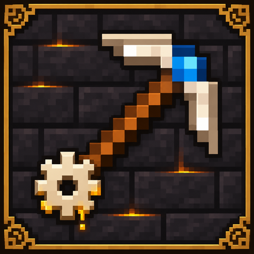

# TinkersNirvana

[简体中文](README.zh-CN.md)

**Version 1.21.1-1.0.2 · Minecraft Java Edition 1.21.1 · NeoForge**

TinkersNirvana ports TinkersAntique to Minecraft 1.21.1. Assemble tools from parts made of different materials, customize them with modifiers, and process materials in the Smeltery, Tinker Tank, and Seared Furnace. The port includes workshops, slime islands, gadgets, the in-game *Materials and You* guide, and refreshed block and item textures.

## Build from source

Run `./gradlew build` with JDK 21. On Windows, run `.\gradlew.bat build`. The mod JAR is written to `build/libs/`.

## Development and customization

- [KubeJS materials and traits](docs/en/KUBEJS.md)
- [Java addon API](docs/en/TOOL_API.md)
- [Register existing addon parts in native workshops](docs/EXTERNAL_PARTS.md)

## License and credits

The project's MIT-licensed portions are covered by the [MIT License](LICENSE). TinkersAntique-derived code and assets retain [LGPL-3.0-only](third_party/TinkersAntique-LICENSE.txt). Mantle-derived code and assets retain [Mantle's MIT license](third_party/Mantle-LICENSE.txt). See the [third-party notices](third_party/NOTICE.md) for attribution to Slime Knights and contributors, and for details on Minecraft-derived artwork. A [Chinese license translation](LICENSE.zh-CN.md) is also available.
