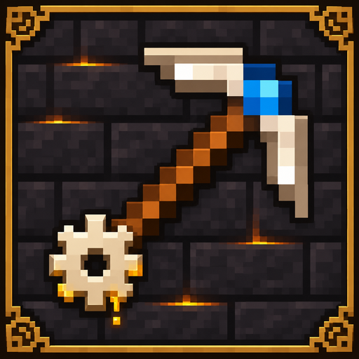

# TinkersNirvana

[English](README.md)

**版本 1.21.1-1.0.3 · Minecraft Java 版 1.21.1 · NeoForge**

TinkersNirvana 将《匠魂怀古》移植到 Minecraft 1.21.1。你可以用不同材质的部件组装工具，借助强化定制工具，并使用冶炼炉、工匠储罐和焦黑熔炉加工材料。移植版包含工坊、史莱姆空岛、实用装置、游戏内宝典《匠魂宝典》，以及重新绘制的方块和物品贴图。

## 从源码构建

使用 JDK 21 执行 `./gradlew build`。Windows 下执行 `.\gradlew.bat build`。构建生成的模组 JAR 位于 `build/libs/`。

## 开发/魔改

- [KubeJS 材料与词条接口](docs/zh-CN/KUBEJS.md)
- [Java 附属开发接口](docs/zh-CN/TOOL_API.md)
- [将附属部件接入原生工作台](docs/EXTERNAL_PARTS.md)

## 许可证与署名

项目中采用 MIT 许可的部分适用 [MIT 许可证](LICENSE)，另附[中文译文](LICENSE.zh-CN.md)。源自匠魂怀古的代码和资源沿用 [LGPL-3.0-only](third_party/TinkersAntique-LICENSE.txt)，源自 Mantle 的代码和资源沿用 [Mantle 的 MIT 许可证](third_party/Mantle-LICENSE.txt)。Slime Knights 及其贡献者的署名和源自 Minecraft 的美术资源说明见[第三方声明](third_party/NOTICE.md)。
